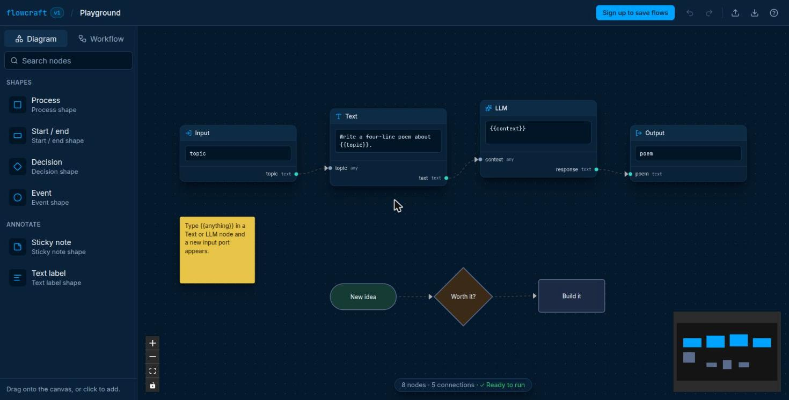
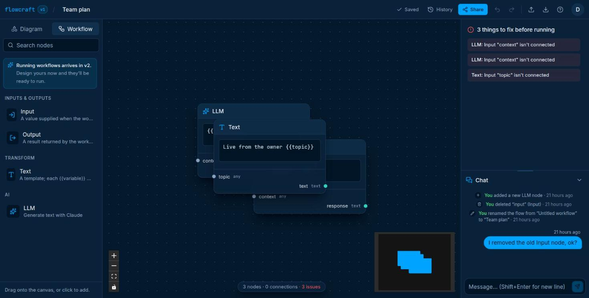

# Flowcraft v1

**Map it out. Then make it run.** Diagrams and AI workflows on one live, collaborative canvas. Sketch a process, design the AI pipeline next to it, and work on it together in real time.

**Live demo:** _add your URL here after deploying_ · No account needed: open **Try it without signing up** on the landing page.



## What you can do in v1

- **Diagram mode:** process, start/end, decision and event shapes, sticky notes and text labels. Resize, restyle, and connect from any side.
- **Workflow mode:** design AI pipelines with typed nodes (Input, Text, LLM, Output). Typing `{{topic}}` in a node creates a matching input port, and a live **run check** flags loops, missing inputs and type mismatches.
- **Real-time collaboration:** several people edit the same flow at once, with live cursors, colour-coded selections and presence avatars.
- **Team chat with the change history in it:** "Ada deleted the LLM node" sits right between the messages that discuss it.
- **Sharing and versions:** invite people as editors or viewers (even before they sign up), publish a view-only public link, save named versions, and restore with one click.
- **Built to be pleasant:** an animated onboarding tour, right-click menus, undo/redo, keyboard shortcuts, JSON export/import, and autosave you never have to think about.



## Coming in v2: AI that actually runs

- **Run workflows** with free built-in AI (or your own key) and watch each step light up live.
- **Agents with tools** that browse, calculate and call other apps, and ask permission before risky actions.
- **Sketch → Workflow:** draw a flowchart, click *Make it run*, and the AI builds the working workflow.
- **An AI teammate on the canvas:** "@ai add a translation step" edits the flow live in front of everyone.
- **Time-travel runs:** replay any run step by step, then re-run from the step you fixed.

## Tech stack

Next.js 16 · React 19 · TypeScript (strict) · React Flow (`@xyflow/react` 12) · Yjs · Hocuspocus (self-hosted Yjs sync) · tRPC 11 + TanStack Query · Better Auth · Postgres (Neon) + Drizzle · Tailwind CSS 4 · Zod 4 · Vitest · Turborepo + pnpm

```
apps/web                  Next.js app: landing, sign-in, dashboard, editor, sharing, tRPC + auth API
apps/collab               Hocuspocus WebSocket server: real-time editing, presence, chat, auto-versions
packages/db               Drizzle schema, migrations, Postgres client
packages/flow-engine      Pure TS: graph validation, topological sort, {{variable}} interpolation
packages/node-registry    Every node type as one typed definition (Zod config schema + ports)
```

### How it fits together

- **Node registry.** A node is one `defineNode({ type, mode, configSchema, ports })` call. The canvas component, inspector form, connection rules and validation all derive from that definition, so adding a node type means adding one entry.
- **Flow document.** The graph lives in a Yjs `Y.Doc` (`apps/web/lib/flow-doc.ts`). React holds a projection of it plus per-user UI state (selection, drag, measured size). Undo/redo uses `Y.UndoManager`, scoped to the local user's edits. The playground persists to IndexedDB; saved flows sync through the Hocuspocus server.
- **Real-time collaboration.** Every open editor joins a Hocuspocus room named after the flow. The web app issues a short-lived JWT (`/api/flows/:id/collab-token`) that says who you are and your role. The collab server only verifies that signature, so it never touches sessions. Viewers connect read-only. Documents load from Postgres and save back (debounced) through `applyFlowUpdate`, which merges under a row lock. Presence (cursors, selections, avatars) travels over Yjs awareness and is never stored. Tabs left in the background or idle pause their connection and rejoin when the person is back (`lib/away.ts`), so a forgotten tab doesn't keep a pay-per-use host running.
- **Autosave, debounced at three levels.** Edits land in the local Yjs doc instantly. They go over the network in 300 ms batches (flushed straight away if the tab is hidden or closed) and reach Postgres 2 s after the last edit, or at least every 10 s during non-stop editing. The status only says "Saving…" when a save is genuinely slow.
- **Activity & chat.** In saved flows the right sidebar is the chat. The inspector only slides in above it when there's something to show: a selected node, or problems stopping a workflow from running. Without a sidebar (the playground, public links), the inspector is a card that floats over the canvas when needed. Each flow keeps a record of who did what (nodes added or deleted, renames, shares, version saves and restores) with chat messages in between. Canvas edits are attributed on the collab server from the connection that sent them, so clients can't fake who made a change. Web-side actions are pushed to the room through an internal, secret-protected `POST /events` endpoint.
- **Sharing & history.** Owners invite people by email as editors or viewers, even before those people sign up, or turn on a view-only public link. Versions are saved by hand or automatically every 10 minutes. Restoring writes the old graph into the live document as a normal edit, so collaborators see it straight away and it can be undone.
- **Accounts.** Better Auth with GitHub and Google sign-in (plus email links when an email service is configured). Each user gets a personal workspace on sign-up. Flows belong to workspaces, and every query checks membership. A flow you can't access returns 404, the same as one that doesn't exist.
- **Onboarding tour.** First-time visitors get a guided tour (`components/tour`). Each step spotlights the real UI while a scripted pointer demonstrates it on look-alike nodes drawn above the canvas, so the user's flow is never touched. The scripts run on the Web Animations API through a small `Stage` helper that stops a step's animation as soon as the user moves on. With reduced motion, the tour shows each step's end state instead.
- **Validation.** `validate()` checks for cycles, port type mismatches, unconnected required inputs and dangling edges. Diagram shapes are ignored, so annotations can share a canvas with a workflow.

## Run it locally

Requires Node 24, pnpm and PostgreSQL.

```bash
pnpm install
createdb flowcraft && createdb flowcraft_test && createdb flowcraft_collab_test
cp apps/web/.env.example apps/web/.env.local   # fill in DATABASE_URL, BETTER_AUTH_SECRET, COLLAB_SECRET
cp apps/collab/.env.example apps/collab/.env   # same DATABASE_URL, same COLLAB_SECRET
DATABASE_URL=<your url> pnpm db:migrate        # repeat for both test databases
pnpm dev          # web on http://localhost:3000, collab server on ws://localhost:1234
pnpm test         # unit + integration tests; needs the flowcraft_test and flowcraft_collab_test databases
pnpm typecheck
pnpm build
```

In development, sign-in email links are printed to the dev server's terminal. After changing `packages/db/src/schema.ts`, run `pnpm db:generate` to create a migration.

## Deploy

Step-by-step guide (Vercel + Neon + a host for the collaboration server, GitHub and Google sign-in): [docs/deploy.md](docs/deploy.md).

## Learn from it

- [LEARNING.md](LEARNING.md): which files to read, in what order, and what each one teaches.
- [docs/diagram-and-workflow.md](docs/diagram-and-workflow.md): how the Diagram and Workflow features behave.

## Roadmap

- ✅ **v1:** typed node registry and engine, Yjs editor, accounts and saved flows, real-time collaboration, sharing and versions, chat with change history, onboarding tour
- 🔜 **v2: AI that runs:**
  - durable run engine
  - universal AI layer with free built-in AI and bring-your-own keys
  - agents and tools (MCP, approvals)
  - Sketch → Workflow, the AI teammate, time-travel runs
  - logic and data nodes
  - knowledge bases with citations
  - triggers, publishing, evals
